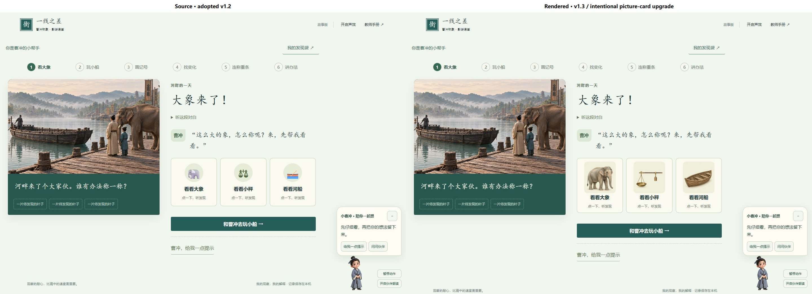
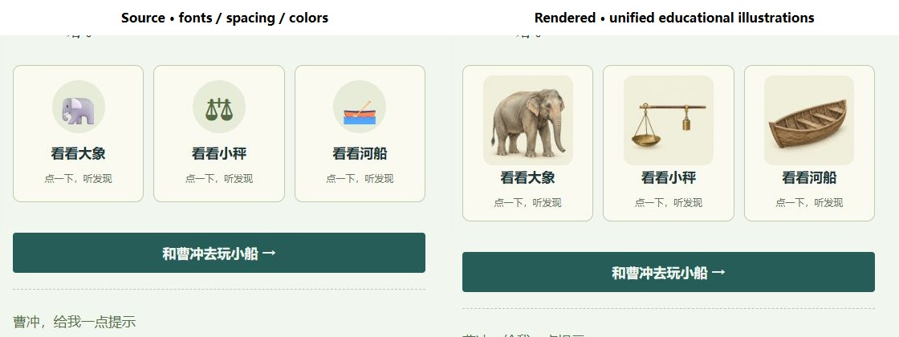
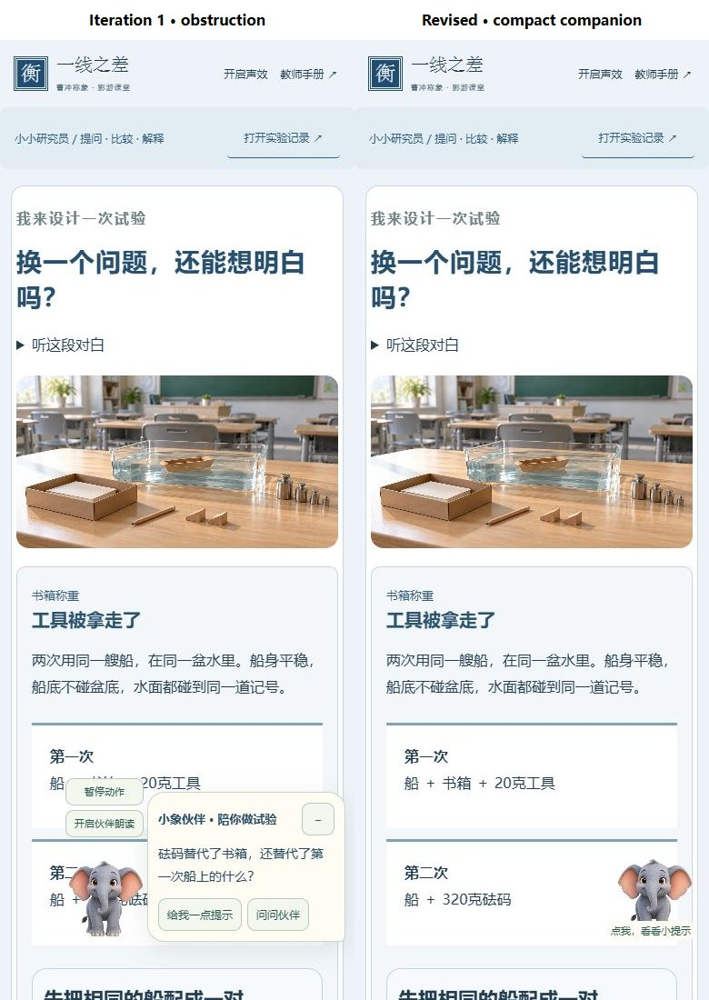

# v1.3 设计与实现对照

日期：2026-10-12。

**final result: passed**

本次沿用已采用的 v1.2 界面作为视觉基线，在同一产品内迭代，并非照抄一张新的设计稿。新图卡、观察窗和配对区是本轮明确的功能性变更，依据[升级方案](docs/24-upgrade-plan-v13.md)检查。未把不同状态的截图当成逐像素一致。

## 对照条件与来源

- Source visual truth：[v1.2故事开场](tests/artifacts/v13/before-story.jpg)。本轮从保留的 v1.2 悬停修正版交付包解出只读基线，在独立4185端口捕获；捕获完成后关闭临时基线服务。
- Implementation：[v1.3故事开场](tests/artifacts/v13/after-story.jpg)。当前4184服务。
- CSS viewport：1440×1000；deviceScaleFactor=1。源图1440×1000；实现图1440×1022（完整文档），全景对照统一取顶部1440×1000。主体与主按钮均在此区域，不以页脚高度差制造误报。
- 状态：故事版／完整学习／prologue／三件物品未查看；伙伴展开；减少动态开启；相同Windows字体与Edge渲染。
- 全景并排：[comparison-story-full.jpg](tests/artifacts/v13/comparison-story-full.jpg)，2880×1044，左右各1440×1000，下方以外无额外缩放。
- 局部并排：[comparison-story-focus.jpg](tests/artifacts/v13/comparison-story-focus.jpg)，1120×420；左右各560px区域，用相同截图原尺寸裁窗查看三张物品卡、文字和按钮。全景之外增加此局部，避免缩放后看不清字号与留白。
- IAB控制工具两次初始化失败；本次通过独立Playwright Edge上下文获取并实际打开截图，不声称在IAB内完成自动操作。

## 五项视觉核对

|核对面|证据与结论|
|---|---|
|字体与层级|沿用既有中文衬线标题、清楚的正文与按钮字；同一系统与字体回退环境对照。实际计算样式记录见[visual-checks.json](tests/artifacts/v13/visual-checks.json)。图证与观察主要文案16px起，长句在手机换行，不截断|
|间距与布局|既有左场景右任务、进度条、右侧伙伴位置保持。新插画比表情图标更大，卡片和主按钮相应下移约24px，是有意的图像可读性调整。新增区小屏自然单列，主按钮可滚动到达|
|颜色与状态|保留故事青绿、实验深蓝和浅纸底。已看、选中、错误均有文字与形状提示；头像透明悬停6%保持。新区域沿用现有颜色语言，未引入抢眼奖励色或闪烁|
|图像质量|采用1536×1024无字六宫格物品图，裁格无邻图漏入。纸盒、木楔与短铅笔和场记一致。角色透明图保持不变。阿舟及水线图证来自真实状态，不用固定剧情图冒充学生观察|
|文字与内容|“我看见什么”“根据记录改一改”“先把相同的船配成一对”等直接描述动作；不把猜中当能力评分。学生页面未出现“演示版”或用户禁止的来源不明提示。具体来源保存在制作研究文档|

## 本轮发现与修复历史

1. **P2／手机伙伴遮挡阅读。** 初次390×1000截图显示展开的浮动对话框盖住书箱两次物品条。修复：手机首次默认小巧伙伴，点角色展开；已有偏好优先。收起仍保留表情、页面反馈和读屏提示。后续同视口重拍：[修复前](tests/artifacts/v13/qa-iteration1-transfer-mobile.jpg)、[修复后](tests/artifacts/v13/transfer-objects-mobile.jpg)、[并排对照](tests/artifacts/v13/comparison-mobile-fix.jpg)。主文字不再被大气泡遮住；小角色可随时展开和收起。
2. **P2／静帧图证与当前阿舟状态不一致。** 首次图卡借用阿舟在岸的固定剧照，人员修正后文字与图不一致。修复：船、水线、人物均复用实时船图，水线与人物局部放大。重新查看[当前图证](tests/artifacts/v13/story-evidence.jpg)，并用自动化覆盖在船与岸上两状态。
3. **P2／未来视频回片后图卡会嵌套播放器。** 修复：图卡、排序拼图与打印小书强制静帧；配对按钮使用物品插画。回归测试把所有媒体video配置为非空，确认图卡不输出video；主场景继续保留独立视频能力。
4. **制作连续性／物品初稿不符场记。** 初稿木宝箱、船桨、有舱船未采用；最终物品为纸盒书箱、短铅笔和两块木楔、开放船。旧草图仅留工作目录，不进入交付清单。

## 学生流程走查

1. 封面与故事开场：模式颜色与物品点击正常，统一插画替代表情图标；通过。
2. 故事讲解卡：三条真实线索、形状干扰、人员未恢复的E4及回查到E2；通过。
3. 实验观察窗：推拉、键盘、单栏按钮、三种问题正反记录、猜想修订和改记后失效；通过。
4. 书箱迁移与学习作品：配对同船、辨认替代物、独立填数、报告及打印；通过。
5. 伙伴与兼容：小屏轻量显示、主动展开提问、透明悬停、减少动态与旧进度续学；通过。

交互证据：[新增浏览器记录](tests/artifacts/v13/reasoning-browser.json)；完整结果见[本版验收](docs/26-acceptance-v13.md)。无页面脚本异常。截图不能代替完整无障碍认证；本次已实测键盘、触屏、减少动态、窄屏与可见控件，未宣称所有辅助技术认证。

## 实施清单

- [x] 同状态同视口全景与局部并排查看。
- [x] 手机遮挡修复并重拍。
- [x] 图证随实际状态变化，返回修改可重新核对。
- [x] 视频与图卡分离，打印保持静帧。
- [x] 保存采用图、提示词、生产衔接与可复验记录。

无未解决的P0/P1/P2。后续课堂可观察实验长页阅读节奏；本轮采用渐进显示猜想卡、折叠数字表和可选小游戏，保留自由摆试验空间。这是课堂验证方向，不声称已经证明教学效果。
