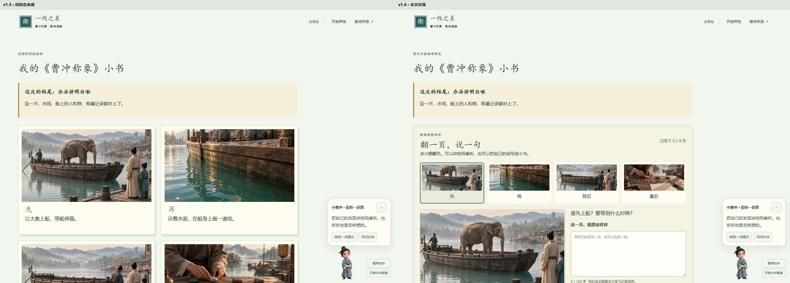
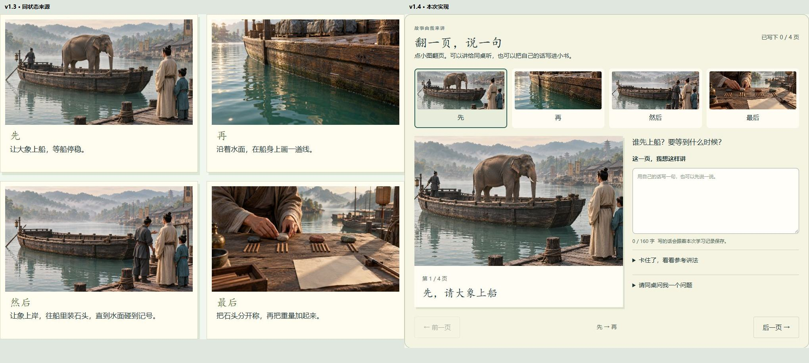
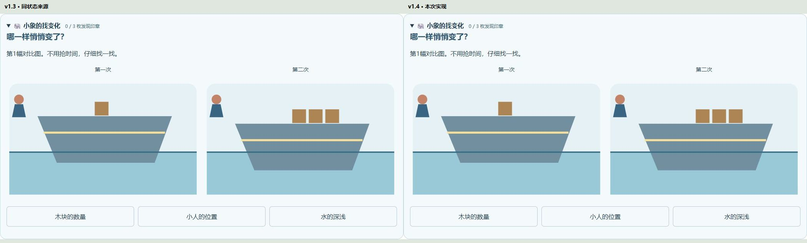

# v1.4 设计与学生流程验收

日期：2026-10-12。

**final result: passed**

本轮沿用v1.3采用界面，升级故事学习作品并增加可选实验修理。全景保持页头、作品标题、结尾摘要和伙伴；逐页大图与图注栏是有意的教学功能变更，不要求复制旧四格排布。

## 来源与对照条件

- 来源：[本轮捕获的v1.3故事作品](tests/artifacts/v14/before-story.jpg)、[原找变化小游戏](tests/artifacts/v14/before-lab-focus.jpg)。
- 实现：[v1.4同状态故事作品](tests/artifacts/v14/after-baseline-story.jpg)、[同状态原小游戏](tests/artifacts/v14/after-baseline-lab-focus.jpg)；新增区域见[故事讲述台](tests/artifacts/v14/after-story-focus.jpg)、[实验修理铺](tests/artifacts/v14/after-lab-focus.jpg)。
- 桌面CSS视口1440×1000，deviceScaleFactor=1，减少动态开启，独立Edge上下文。两版均处于故事reflect、E1、未写图注；实验校准均在observe打开原找变化首组。
- 来源故事全图1440×2151，实现全图尺寸见[实际捕获元数据](tests/artifacts/v14/visual-comparison.json)。全景用各自顶部1440×1000，在2880×1036画布并排。
- 故事局部取原四格与新讲述台，均1020px宽，放入同尺寸1020×880裁窗，无缩放；多出区域留空。两者功能不同，明确作为既有美术和文字层级的延续对照。
- 实验原小游戏两图均1050×590，以1:1放在2100×636画布比较；新增修理区另查完整截图。手机使用390×1000，并补测320、768、1440像素及390×844真实触摸上下文。
- IAB工具初始化报运行时错误，采用已有项目的Playwright/Edge验证。未操作用户正在使用的学习存档。截图均在本轮捕获、实际打开查看。

## 五项视觉核对

|核对面|证据与结果|
|---|---|
|字体与层级|沿用既有中文书写感标题与微软雅黑正文；主要问题、按钮、图注16px起。故事页签只写先、再、然后、最后，避免手机两行编号挤压。|
|间距与布局|故事大图与自写区桌面并排，手机单列；四枚缩略图仍可连续选择。新修理默认折叠，不把必做实验变成更长的展开页。|
|颜色与状态|延续故事青绿暖纸、实验浅蓝深蓝。修理选中按钮最终深蓝底白字，选中还有aria-pressed；原头像保持透明。|
|图像质量|复用实际采用的四幅剧情静帧，缩略图和大图均正常解码；修理图复用随条件更新的教学图，未另造相互矛盾的A/B图片。|
|文字与归属|“这一页，我想这样讲”“动手调一调B栏”直接说明动作；参考讲法单列；空图注打印真实留白。游戏记录与正式研究分开，不夸大过关含义。|

## 发现、修复与复查

1. **P2：故事图注区域误继承旧深色舞台。** [首次截图](tests/artifacts/v14/iteration1-compare-story-focus.jpg)显示深底深字。首次仅调整子类不足以消除父级背景；进一步定位旧story-stage规则，将新舞台与文本区改为独立retell命名。上方最终并排和[最终手机讲述台](tests/artifacts/v14/after-story-mobile-focus.jpg)确认恢复暖纸底，文字可读；自动检查同时覆盖子级与父级。
2. **P2：实验选中按钮浅底白字。** 既有实验全局规则覆盖新背景，见[首次手机截图](tests/artifacts/v14/iteration1-after-lab-mobile-focus.jpg)。提高新组件选择器的限定范围，最终选中背景为rgb(49,93,126)，白字保留；[最终手机修理图](tests/artifacts/v14/after-lab-mobile-focus.jpg)可见。小伙伴仍在右下，键盘聚焦的操作会滚动避开角色；触摸完成首组与进入下一组也实测通过。
3. **P2：空图注被打印成系统代填的第一人称。** 改为真实手写留白，参考讲法单列；单元测试检查四页空白及纯文本转义。
4. **P2：短路线修理记录缺少回看和打印。** 接入通用日志、反思与打印入口；完整路线和旧路线分别检查，避免重复显示。
5. **P2：修好后键盘焦点跳到正式实验。** 完成按钮替换后优先停到“接下一组委托”，下一组落到当前修理控件；连续Enter操作不会改变正式实验木块数。

后三项由独立只读审查发现，修改后另行复核通过。前两项完成修复后重拍并重新打开对照；没有把构建成功代替视觉验收。

## 学生流程

1. 进入自己的小书：结果、图片和下一步清楚；通过。
2. 翻页、口述、自写、参考与同桌追问：可选，键盘操作和中文输入不失焦；通过。
3. 刷新、打印、导出：当前页和原文保留，空白不代填，保存受限有准确提示；通过。
4. 打开修理铺、修改B、解释、检查：真实条件判定，接受不同合法方案；通过。
5. 下一组、重摆、回看：前后记录独立保留，正式试验与结局不变；通过。
6. 手机与伙伴：320px起无横向溢出，新按钮至少44px目标尺寸，透明头像保留；通过。

证据：[13项新增浏览器检查](tests/artifacts/v14/workshop-browser.json)、[真实触摸补验](tests/artifacts/v14/touch-workshop.json)、[本版完整验收](docs/29-acceptance-v14.md)。本次不声称覆盖所有辅助技术，也不把功能测试等同于真实班级教学效果。课堂可继续观察逐页提示是否帮助学生用自己的话解释，以及实验修理后能否迁移到独立研究。
