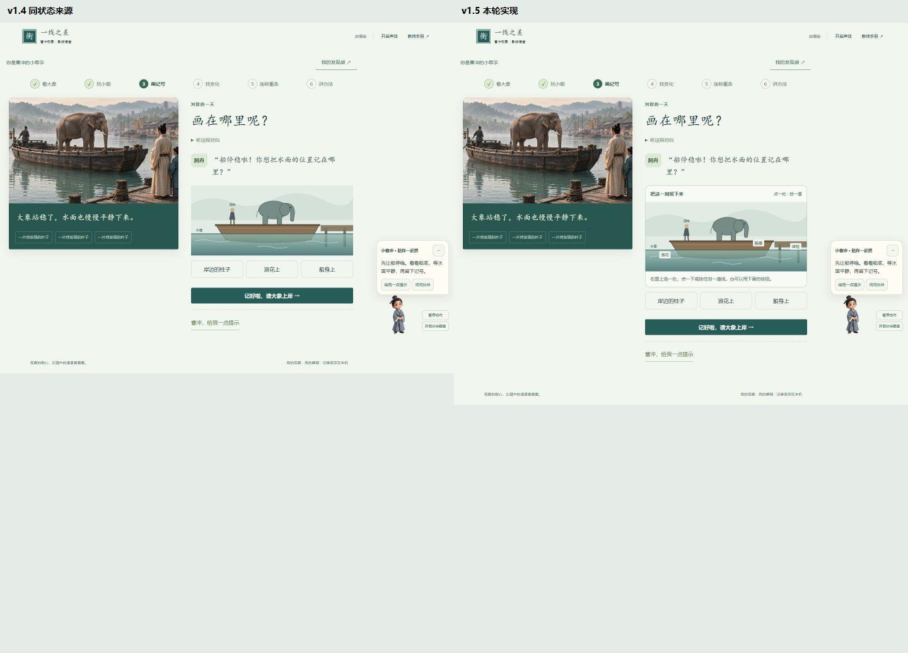
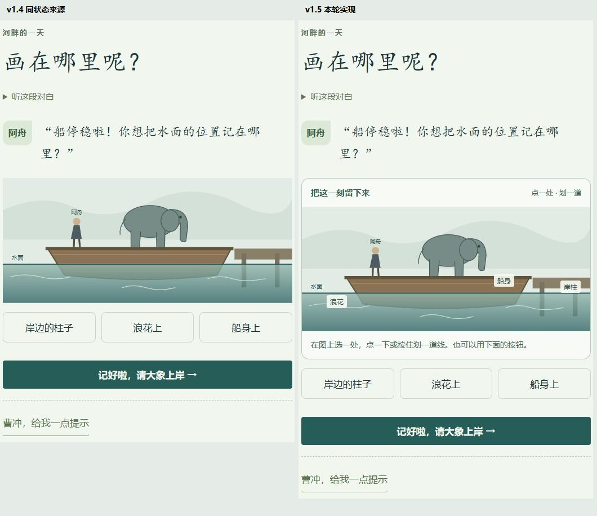
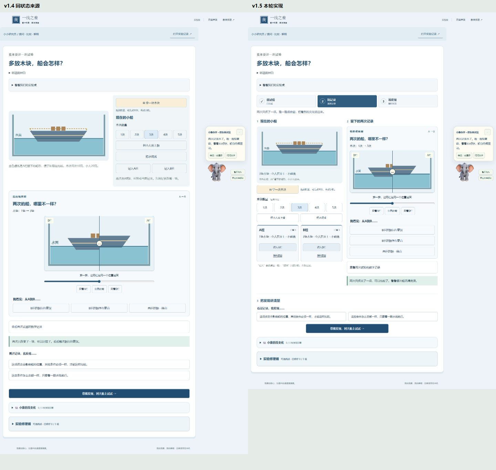
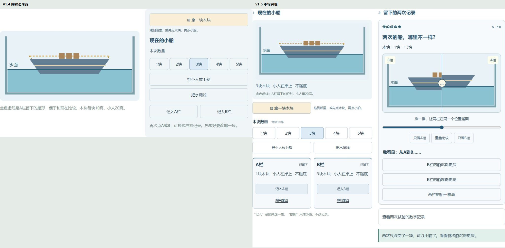
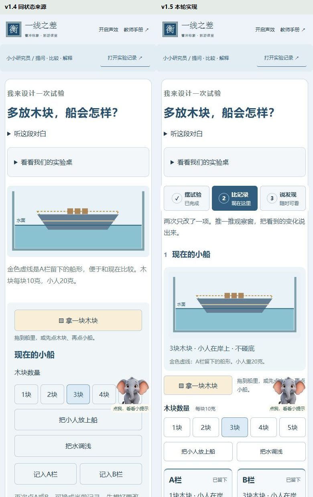

# v1.5 设计与学生流程验收

日期：2026-10-12。

本轮以当轮捕获的v1.4页面为视觉来源，延续其影视图、中文字体、河岸绿与实验蓝。画线区域、并排实验桌与三步导航属于明确的功能升级，不按旧布局逐像素复刻。

## 来源与对照条件

- 来源：[故事完整页](tests/artifacts/v15/before-story-1440.jpg)、[实验完整页](tests/artifacts/v15/before-lab-1440.jpg)、[手机实验页](tests/artifacts/v15/before-lab-390.jpg)；均在改动前本轮捕获。
- 实现：[故事完整页](tests/artifacts/v15/after-story-1440.jpg)、[实验完整页](tests/artifacts/v15/after-lab-1440.jpg)、[手机实验页](tests/artifacts/v15/after-lab-390.jpg)。
- CSS视口1440×1000、390×1000，deviceScaleFactor=1，减少动态开启；相同未选记号的story/mark状态、相同A=1块/B=3块且未解释的lab/observe状态。
- 故事全图由1440×1112变为1440×1212；实验全图由1440×2567变为1440×2189。两幅全景均以0.5倍放在同一画布对照。
- 故事局部均523px宽，来源高749、实现高849，1:1并排。实验局部来源为原1050×533操作区，实现为1050×992双栏区；这是有意改变信息组织，同一画布按同一比例归一化，尺寸见[元数据](tests/artifacts/v15/visual-comparison.json)。
- 手机来源390×2970、实现390×3135；以1:1并排检查首屏与操作区域，另查完整图及320/768断点。不声称手机整页变短；新增步骤导航解决往返定位。
- IAB初始化失败，沿用项目已有的独立Playwright/Edge测试上下文。未操作用户学习存档。所有对照均实际打开查看，不以路径或代码代替视觉检查。

## 五项视觉核对

|核对面|结果|
|---|---|
|字体与层级|沿用宋体类故事标题、微软雅黑正文；实验标题保持黑体层级。主要问题与操作16px左右，记录卡次级操作14px、状态12px；中文不截断，允许自然换行。|
|间距与布局|桌面将当前小船与已存记录并排；结论区横向铺开，减少单边空白。手机单列，三步导航保留定位。图上浪花按钮移到左侧水面，避免与船身触控区相叠。|
|颜色与状态|沿用河岸绿、浅纸色与实验蓝；深蓝明确标出当前步骤，文字状态区别于颜色。未记录的A/B摆回按钮禁用，记录存在后可操作。|
|图像与清晰度|影视采用图、人物造型和透明伙伴均保留，没有以新代码图替代影视资产。既有实时教学图继续用于表达载荷；图上划线是交互层，图片比例未拉伸。伙伴悬停仍透明并略放大。|
|措辞与内容|使用“摆试验、比记录、说发现”“照A摆回”等具体动作。“记入”和“摆回”明确区分。未写的反思留白，问题另列；不出现用户禁止的学生端文案。|

## 迭代发现与修复

1. **P2：手机轻点被焦点滚动打断。** 初版pointerup后焦点避让移动目标，随后click落到BODY。改为指针抬起统一提交；显式区分指针与键盘，不根据程序触发的focus-visible猜输入方式。直接CDP触摸验证记号保存且scrollY不变。
2. **P2：图外第二指没有取消笔迹。** 原先先过滤落点再查多指；修为任何第二指都先取消已有笔迹。新增真实双指回归，随后仍可单指点选。
3. **P2：固定步骤栏遮挡倒退Tab焦点。** 为实验控件提供滚动间距，并检查固定栏与焦点矩形。summary、range、role=button均纳入。
4. **P2：768px展开伙伴挡住B栏键盘操作。** 检查完整消息面板、头像及设置区，覆盖所有屏宽。独立审查复测320/390/768/1440正反向Tab，另测768先触摸后Tab。
5. **P2：首轮实验页结论区挤在右侧，左侧留白较多。** 结论区移至双栏之后，桌面两个解释选项并排，手机纵排。已重新捕获最终全景与局部。
6. 初轮截图保存在v15目录的iteration1文件；最终同状态对照见上。局部截图采用页面坐标截取，避免截图工具自动滚动后把固定导航拍进操作区。

## 检查完成项

- 图上点击、划线、键盘、取消、画布外松开、多指、刷新恢复。
- A/B重摆与正式记入分离，先B后A，真实状态决定步骤进度。
- 320/390/768/1440无横向溢出；新增按钮不小于44px。
- 触屏划线、轻点不跳页、减少动态、键盘正反向、伙伴遮挡。
- 两版主线、旧记录、故事书、实验修理、打印、媒体回退及控制台错误回归。
- 独立代码审查发现已关闭，无遗留P1/P2。真实课堂学习成效仍由教师观察学生解释与迁移，自动化通过仅证明所测软件行为。

**final result: passed**
